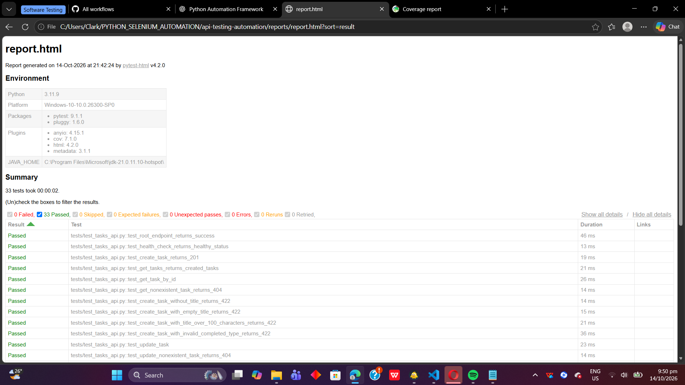
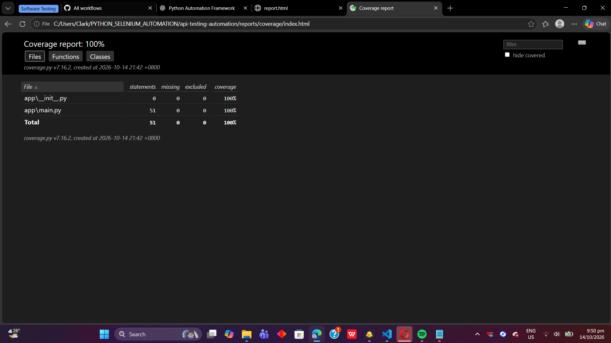

# Task Management API — Test Automation Portfolio


[](https://github.com/cjdaprogrammer/api-testing-automation/actions/workflows/tests.yml)

## Overview

This project demonstrates automated REST API testing for a Task Management API built with FastAPI. It focuses on validating API functionality, HTTP status codes, input validation, error handling, and CRUD operations.

The project combines automated Python tests, Postman collection testing, code coverage reporting, and continuous integration through GitHub Actions.

**Portfolio objective:** demonstrate practical QA automation skills relevant to a Junior QA Engineer role.

## Technology Stack

- Python 3.11
- FastAPI
- Pytest
- HTTPX
- Pytest-Cov
- Pytest-HTML
- Postman CLI
- Git and GitHub
- GitHub Actions

## Features Tested

- API health check and root endpoint
- Create, retrieve, update, and delete tasks
- Retrieve all tasks and individual tasks by ID
- Successful and unsuccessful HTTP responses
- Missing, empty, whitespace-only, and oversized titles
- Description length boundaries
- Invalid input types and request payloads
- Nonexistent resources and deleted tasks
- Data integrity after invalid update attempts
- Automatic test execution in CI

## Project Structure

```text
api-testing-automation/
├── .github/
│   └── workflows/
│       └── tests.yml
├── app/
│   ├── __init__.py
│   └── main.py
├── docs/
│   ├── TEST_PLAN.md
│   ├── BUG_REPORT.md
│   └── TEST_EXECUTION_REPORT.md
├── postman/
│   └── Task_Management_API.postman_collection.json
├── reports/
├── tests/
│   ├── __init__.py
│   └── test_tasks_api.py
├── .gitignore
├── pytest.ini
├── requirements.txt
└── README.md
```

## Getting Started

### 1. Clone the repository

```bash
git clone https://github.com/cjdaprogrammer/api-testing-automation.git
cd api-testing-automation
```

### 2. Create a virtual environment

```bash
python -m venv .venv
```

Activate it on Windows PowerShell:

```powershell
.\.venv\Scripts\Activate.ps1
```

### 3. Install dependencies

```bash
python -m pip install --upgrade pip
pip install -r requirements.txt
```

### 4. Run automated tests

```bash
python -m pytest -v
```

### 5. Generate HTML and coverage reports

```bash
python -m pytest -v --cov=app --cov-report=term-missing --cov-report=html:reports/coverage --html=reports/report.html --self-contained-html
```

After a successful run, open the reports:

- Pytest HTML report: `reports/report.html`
- Coverage report: `reports/coverage/index.html`

These reports are generated locally and are not necessarily committed to the repository.

## Run the API Locally

Start the development server:

```bash
uvicorn app.main:app --reload
```

Available endpoints:

| Method | Endpoint | Purpose |
|---|---|---|
| GET | `/` | API information |
| GET | `/health` | Health check |
| POST | `/tasks` | Create a task |
| GET | `/tasks` | Retrieve all tasks |
| GET | `/tasks/{task_id}` | Retrieve a task |
| PUT | `/tasks/{task_id}` | Update a task |
| DELETE | `/tasks/{task_id}` | Delete a task |

Interactive API documentation is available at `http://127.0.0.1:8000/docs`.

**Note:** The current implementation stores tasks in memory. Data resets when the application restarts, so this project is intended as a testing portfolio demonstration rather than a production persistence solution.

## Postman Collection

The repository includes a Postman collection with 15 requests covering positive scenarios, negative scenarios, CRUD operations, and input-length boundaries.

Start the API server in one terminal. In another terminal, run:

```bash
postman collection run ./postman/Task_Management_API.postman_collection.json --reporters cli
```

The collection uses `http://127.0.0.1:8000` as its default base URL. The Postman CLI must be installed and available in your terminal.

## Continuous Integration

GitHub Actions automatically runs the project's automated checks when configured push or pull-request events occur.

The workflow installs dependencies, runs pytest with coverage and HTML reporting, uploads reports as artifacts, starts the API server, and executes the Postman collection.

See the [GitHub Actions workflow](https://github.com/cjdaprogrammer/api-testing-automation/actions/workflows/tests.yml) for execution results.

## QA Approach

This project demonstrates several testing techniques:

- **Functional testing:** verify API behavior against expected results.
- **Positive testing:** submit valid requests and verify successful responses.
- **Negative testing:** submit invalid requests and verify appropriate errors.
- **Boundary-value analysis:** test values at and beyond defined input limits.
- **Data integrity testing:** verify invalid updates do not modify existing task data.
- **Regression testing:** rerun automated tests after code changes.
- **CI testing:** execute automated checks through GitHub Actions.

## Project Results

Latest results previously reported during development:

- **33 pytest tests passed**
- **100% statement coverage** for `app/main.py`
- **15 Postman requests** passing
- **GitHub Actions workflow:** green

These results reflect the reported development runs. Check the latest CI run for the current verified results.

## Future Improvements

- Add persistent database storage.
- Introduce authentication and authorization tests.
- Add API response-time checks.
- Add environment-specific configuration.
- Expand schema and security validation.
- Add tests against a deployed staging environment.

## Author

Junior QA Engineer portfolio project demonstrating API automation, test design, validation, reporting, and continuous integration.

**Repository:** https://github.com/cjdaprogrammer/api-testing-automation

## Test Evidence

### Automated Test Results

The latest local test run completed with **33 passed and 0 failed**.



### Code Coverage

The coverage report shows **100% statement coverage** for the application module.



### Continuous Integration

GitHub Actions successfully completed the latest workflow run on the `main` branch.


> Note: Statement coverage measures executed statements; it does not guarantee that the application is free of defects.